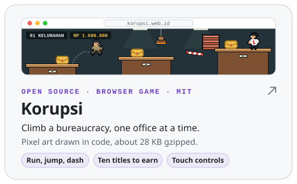
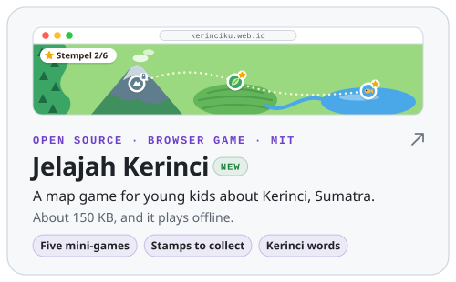

<!-- The cards are SVGs in assets/readme, each with a light and a dark variant. To change their text or colors,
     edit scripts/build-readme-assets.py and run: python3 scripts/build-readme-assets.py -->

<a href="https://debikurnia.id"><picture><source media="(prefers-color-scheme: dark)" srcset="assets/readme/hero-dark.svg"></picture></a>

<a href="https://debikurnia.id"><picture><source media="(prefers-color-scheme: dark)" srcset="assets/readme/btn-website-dark.svg"></picture></a> <a href="https://www.linkedin.com/in/debikurnia"><picture><source media="(prefers-color-scheme: dark)" srcset="assets/readme/btn-linkedin-dark.svg"></picture></a> <a href="mailto:debi@elysiumx.org"><picture><source media="(prefers-color-scheme: dark)" srcset="assets/readme/btn-email-dark.svg"></picture></a>

<a href="https://opustock.com"><picture><source media="(prefers-color-scheme: dark)" srcset="assets/readme/opustock-dark.svg"></picture></a>

<a href="https://nyetok.id"><picture><source media="(prefers-color-scheme: dark)" srcset="assets/readme/nyetok-dark.svg"></picture></a>

<a href="https://github.com/XNyetok/Havus"><picture><source media="(prefers-color-scheme: dark)" srcset="assets/readme/havus-dark.svg"></picture></a><a href="https://github.com/XNyetok/Jambul"><picture><source media="(prefers-color-scheme: dark)" srcset="assets/readme/jambul-dark.svg"></picture></a>

<a href="https://github.com/XNyetok/korupsi"><picture><source media="(prefers-color-scheme: dark)" srcset="assets/readme/korupsi-dark.svg"></picture></a><a href="https://github.com/XNyetok/Kerinciku"><picture><source media="(prefers-color-scheme: dark)" srcset="assets/readme/kerinci-dark.svg"></picture></a>

<a href="https://github.com/kirodotdev/Kiro/issues/9507#issuecomment-4808333640"><picture><source media="(prefers-color-scheme: dark)" srcset="assets/readme/kiro-dark.svg"></picture></a><a href="https://elysiumx.org"><picture><source media="(prefers-color-scheme: dark)" srcset="assets/readme/elysiumx-dark.svg"></picture></a>

 <picture><source media="(prefers-color-scheme: dark)" srcset="https://skillicons.dev/icons?i=php%2Claravel%2Cpy%2Cjs%2Cswift%2Cmysql%2Ctailwind%2Cgit&perline=8&theme=dark"></picture><picture><source media="(prefers-color-scheme: dark)" srcset="assets/readme/stack-ai-dark.svg"></picture>

<picture><source media="(prefers-color-scheme: dark)" srcset="https://raw.githubusercontent.com/debikurnia/debikurnia/output/snake-dark.svg"></picture> 

